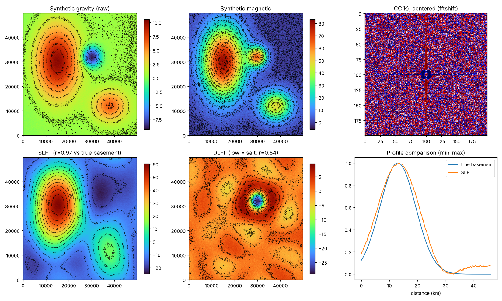

# gravmag-wcf — 중력·자력 데이터 파수 상관 필터링(WCF)과 SLFI·DLFI

석사 학위논문 **「Characterization of Salt and Basement Structures in the Ghasha Area Using Wavenumber Correlation Analysis of Gravity and Magnetic Anomaly Data」**(전북대학교, 2026)와 **SPE Journal 논문(제1저자, 2026)**에서 사용한 분석 코드를 정리한 저장소입니다.

> 실제 연구 데이터(아부다비 가샤 지역 항공 중력·자력 자료, 공동연구 기관 모델)는 포함하지 않습니다. 대신 **합성 데이터로 전체 흐름을 재현하는 예제**를 넣었습니다.



## 무엇을 하는 코드인가

두 종류의 2D 지구물리 데이터가 겹쳐 있을 때, **파수(주파수) 성분마다 두 데이터가 같은 방향으로 움직이는지 반대로 움직이는지**를 보고 성분을 나눕니다.

| 성분 | 의미 | 지표 |
|---|---|---|
| CC(k) > 0 | 중력·자력이 함께 움직임 → 무겁고 자성 있는 **기반암** | **SLFI** (Summed Local Favorability Index) |
| CC(k) < 0 | 서로 반대로 움직임 → 가볍고 자성 없는 **암염** | **DLFI** (Differential Local Favorability Index) |

## 처리 흐름

```
중력(부게 이상) ──► 상향 연속 ──┐
                               ├─► 정규화(z-score×10) ─► 평균 제거 ─► FFT ─► CC(k) = cos(Δθ_k)
자력(DRTP)      ───────────────┘                                              │
                                     ┌────────────────────────────────────────┤
                                     ▼                                        ▼
                         SLFI = IFFT(A·M⁺) + IFFT(B·M⁺)          DLFI = IFFT(B·M⁻) − IFFT(A·M⁻)
                         M⁺ = [0.5 ≤ CC(k) ≤ 1.0]                M⁻ = [−1.0 ≤ CC(k) ≤ −0.5]
                                     │                                        │
                                     └──────────► 검증: 기존 독립 모델 3개와 공간·측선·3D 비교
```

### 임계값을 정한 방법 (`threshold.py`)

- **상향 연속 높이**: 높이별 두 데이터의 상관계수 곡선에서, 양 끝을 잇는 직선과 가장 멀리 떨어진 점(꺾이는 점) → 논문에서 **1,500 m**
- **CC(k) 구간**: 경계를 옮겨 가며 *남는 신호 에너지(%)*와 *필터 후 상관계수*를 함께 계산 → 논문에서 SLFI 구간 **0.5~1.0** (원래 에너지의 약 절반 유지, 상관계수 0.85)

## 설치와 실행

```bash
pip install -e .
python examples/synthetic_demo.py     # examples/output/ 에 그림 저장
pytest -q                             # 7개 테스트
```

합성 예제 출력 (seed 고정):

```
선택한 상향 연속 높이: 1500 m
SLFI vs 기반암 정답 r = 0.973
−DLFI vs 암염 정답  r = 0.543
```

합성 데이터에서는 암염과 기반암 신호가 같은 파수 대역에 많이 겹쳐 있어 DLFI의 상관이 SLFI보다 낮지만, 지도에서는 암염 위치가 가장 낮은 값으로 뚜렷하게 나타납니다.

## 사용 예

```python
import gravmag_wcf as gw

mag, ext = gw.read_grid("DRTP.asc")            # 자력
grav, _  = gw.read_grid("gravity_up1500.dat")  # 상향 연속한 중력
mag, ext = gw.crop_grid(mag, ext, crop=(xmin, xmax, ymin, ymax))

cck, A, B = gw.correlation_spectrum(gw.prepare(mag), gw.prepare(grav))
curves = gw.energy_curves(A, B, cck)            # 임계값 근거 곡선
slfi = gw.slfi_dlfi(A, B, cck, 0.5, 1.0).slfi
dlfi = gw.slfi_dlfi(A, B, cck, -1.0, -0.5).dlfi
```

## 구성

```
src/gravmag_wcf/
  io.py         ASC·XYZ 격자, Surfer BLN 경계선 읽기, 자르기
  wcf.py        정규화, CC(k), SLFI·DLFI, 남는 에너지, 상향 연속
  threshold.py  에너지-상관 곡선, 꺾이는 점(knee) 찾기
  validate.py   Pearson·Spearman, 깊이별 상관, 측선 추출, 위치 보정
  plotting.py   등고선 지도, 에너지 곡선
examples/synthetic_demo.py
tests/test_wcf.py
docs/original_notebooks.md   원본 노트북과의 대응표
```

## 원본 코드와의 관계

연구 중에는 Colab 노트북 두 개(`Correlation Code v5.1`, `Validation Code v1.0`, 합계 약 1만 6천 줄)로 작업했습니다. 이 저장소는 그중 **실제로 결과를 만든 함수만 골라** 정리한 것입니다.

- 노트북 셀마다 복사돼 있던 같은 함수(예: SLFI·DLFI 계산 5곳, 격자 읽기 6곳)를 하나로 합쳤습니다.
- 개인 PC 경로, 조사 지역 좌표, 데이터 파일명은 모두 인자로 바꿨습니다.
- 계산식은 원본과 같습니다 (`scipy.fftpack` → `numpy.fft` 만 변경).
- `upward_continue()`와 `best_shift()`는 원본에서 다른 프로그램·별도 작업으로 처리하던 단계를, 합성 예제에서 흐름 전체를 재현하기 위해 다시 구현한 것입니다.

자세한 대응은 [docs/original_notebooks.md](docs/original_notebooks.md)를 보세요.

## 관련 결과

- 석사 학위논문 (전북대학교 대학원 환경에너지융합학과, 2026.08)
- SPE Journal (SCIE) 제1저자, 2026 — https://doi.org/10.2118/236968-PA
- 포트폴리오 — https://0ju12.github.io
